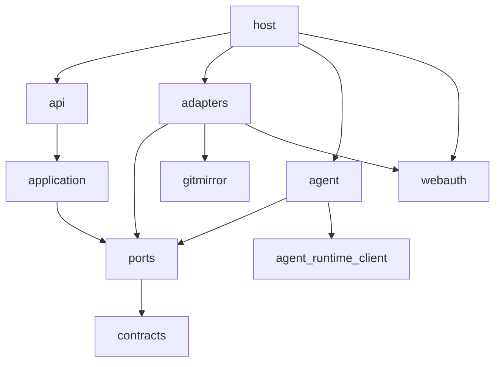

# Architecture

Audience: an engineer or agent about to change presentator who needs the
mental model first: what the parts are, which way they depend, and what the
design rests on. Exact behaviour lives in the [reference](reference/), the
reasons behind the guards in
[trust boundaries](explanation/trust-boundaries.md), the wish in
[VISION.md](VISION.md).

presentator is one web service that mirrors Slidev decks from git remotes,
builds each one sealed in a second service, and serves the built talk on its
own origin, with an AI co-presenter as an overlay in the presenter's browser.

## 1. Context


- Keycloak signs people in; its groups decide who may enter.
- The operator's model gateway answers the co-presenter, through the
  agent-runtime client at the tag `pyproject.toml` pins.
- Git remotes hold the decks; presentator only reads them.
- hal and edge deploy the instance from `compose.yaml` and host the legal
  pages that presentator's section (`legal/datenschutz.html`) joins.
- The speech service speaks and hears over a private Unix socket.

## 2. Building blocks



- **Layers.** `host` composes the instance and depends on `api`, `application`,
  `ports`, `contracts` and on the adapters, which fill the ports (`adapters`
  and `agent`). Each depends only downward; an adapter never reaches up into
  `application`, `api` or `host`, and only the host names an adapter. The import-linter
  contracts in `pyproject.toml` enforce this, run by the quality gate's
  `import-contract` rule. A third-party or format library lives only in the
  adapter that owns it, and its contract is written with its first import.
- **`src/gitmirror`** sits beside the layers: it mirrors any remote read-only
  through `git`, does not import `presentator`, and only adapters name it.
- **`presentator.agent`** is the only package that imports
  `agent_runtime_client`.
- **webauth** owns the sign-in routes, the gate, the origin check, the body
  caps and the cookies; presentator's SQLite stores fill its ports.
- **`frontend/`** is a SvelteKit single-page shell (`adapter-static`,
  `ssr = false`), built in the image; FastAPI serves it and no Node service
  runs.
- **`slidev/`** is the toolchain that owns every theme and addon a deck may
  name. The co-presenter overlay is its addon `slidev-addon-presentator`.
- **The build worker** (`host/worker.py`) is the second service: it runs every
  step of a deck's build sealed. See [builds](reference/builds.md).

## 3. Runtime

```mermaid
sequenceDiagram
    participant G as git remote
    participant W as web (poll or hook)
    participant M as mirror (files)
    participant B as build worker
    participant T as talk host
    W->>G: fetch (polling, or the fetch-now hook; no payload read)
    W->>M: update bare mirror
    W->>B: build deck (sealed)
    B-->>W: built talk and PDF
    T->>T: serve the talk to its owner
```

Polling runs in the host process (`host/polling.py`); the fetch-now hook
(`api/hooks.py`) triggers the same pull and reads no payload. See
[sources](reference/sources.md), [builds](reference/builds.md) and
[decks](reference/decks.md).

## 4. Deployment

`compose.yaml` defines two services, `presentator` (web) and `build-worker`.
hal deploys it with `hal apply`. One process serves the lobby and the talk
host and tells them apart by the `Host` header (`served_by_host` in
`host/main.py`); a request for any other host gets a 404. See
[start an instance](runbooks/start-an-instance-in-a-container.md) and
[configuration](reference/configuration.md).

## 5. Crosscutting concepts

**Persistence.** SQLite holds accounts, sessions, preferences, sources, runs,
decks and key drafts; files hold mirrors and builds. A row names a path and
the database holds no blob. `builds/` and `mirrors/` are caches the rows
rebuild. One process writes the database, and the identity lock depends on
that; a second writer would need a unit of work. A column goes in two
releases, the second dropping it in `create_tables`, gated on
`pragma_table_info` (`adapters/schema.py`), so a restorable older backup still
starts.

**Authentication.** Keycloak groups decide who may enter
([sign-in](reference/sign-in-and-session.md)). There is no Redis: rate limits
are single-process (`SingleProcessRateLimitBackend`) and there is no session
cache. Identity writes run in one transaction under a process lock, with the
audit line after COMMIT (`adapters/identity.py`).

**Wire and errors.** JSON lives under `/api/` and every answer is a typed
model. A signed-out path is one exact optional path (`GET /api/session`),
never a prefix or a catch-all. A store failure while resolving a reader is a
500, never a signed-out answer. Problems follow RFC 9457 (`api/problems.py`),
and a problem type is a `tag:` URI, because an https address breaks when its
page moves. OpenAPI is generated, not served.

**Words and look.** Every lobby word comes from the gettext catalogs through
Babel (`adapters/catalog.py`), and `scripts/check_catalog_purity.py` holds the
pages to it; a language is a file. The language is the instance's and the
theme is the person's. The look comes from appkit, with presentator's teal in
the app slot (`frontend/src/app.css`). The overlay's controls use English
literals, and the room notice follows the deck's language.

**Trust.** A deck author's code, git remotes and people's input are
untrusted. The operator's settings, his local sources folder and hal's token
clients are trusted. The reason for each guard is in
[trust boundaries](explanation/trust-boundaries.md). No operator blessing
narrows this model yet, so an audit keeps the default trust model.

## 7. Risks

- The overlay's palette can clash with a deck's palette.
- A second writing process would need a second write lock.
