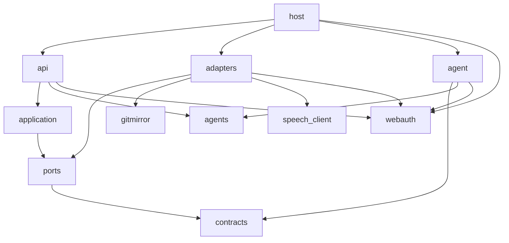
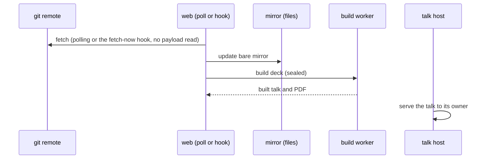
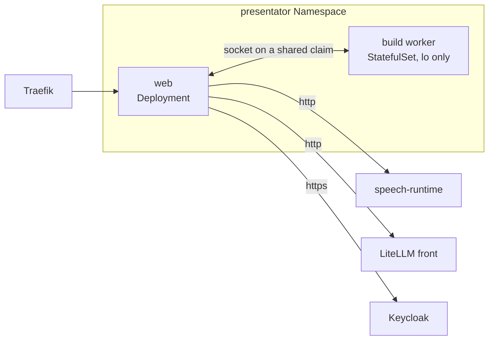

# presentator architecture

Audience: an engineer or agent about to change presentator who needs the mental model first. Exact
behaviour lives in the surface pages routed from the [README](../README.md#documentation), the wish
in [VISION.md](VISION.md).

presentator is one web service that mirrors Slidev decks from git remotes, builds each one sealed in
a second service, and serves the built talk on its own origin, with an AI co-presenter as an overlay
in the presenter's browser.

## 1. Context and Scope

## 2. Building Block View

- **Layers.** `host` composes the instance and alone names an adapter; layers depend only downward
  (import-linter in `pyproject.toml`, the gate's `import-contract` rule). A library an adapter owns
  behind a port is barred above the adapters; webauth is barred only from `application`, `ports`,
  `contracts`. `api` alone may import `agents.tools`, to declare beside each route whether an agent
  may call it (`tests/presentator/agent/test_backend_imports.py` holds that line, which
  import-linter cannot draw inside one package).
- **`src/gitmirror`** mirrors any remote read-only through `git` and does not import `presentator`.
  Only adapters import it, and `speech_client`, the pinned client that owns the speech wire.
- **webauth** owns the sign-in routes, the gate, the origin check, the body caps and the cookies;
  presentator's SQLite stores fill its ports.
- **`frontend/`** is a SvelteKit single-page shell built in the image; FastAPI serves it and no Node
  service runs.
- **`slidev/`** owns every theme and addon a deck may name, among them the overlay addon
  `slidev-addon-presentator`.

## 3. Runtime View

## 4. Deployment View

presentator has one deployment, on the platform's k3s cluster. One image runs as two workloads in
presentator's own Namespace: the web, a one-replica Deployment that recreates instead of rolling,
and the build worker, a one-replica StatefulSet, both on the node of one claim mounted at
`/run/presentator-build`, where the worker's socket lies. The platform's manifest
(`apps/presentator` in overnightworks/platform) owns the pod specs, network policy, edge, secrets,
the database backup with its restore test and the release; the [configuration](configuration.md)
owns what each setting means.

One process serves the lobby and the talk host and tells them apart by the `Host` header; any other
host gets a 404, except the lobby's back-channel logout path ([sign-in](sign-in.md)), which ignores
forwarded headers and trusts only the signed Logout Token. The platform's realm registers no logout
URL for presentator, so its safety does not depend on the call. `GET /health` answers a fixed 200,
and the port opens only after the database is migrated and the worker answers.

The worker's pod holds `lo` alone because the init container `remove-link` deletes its network link
first; its container never restarts, so each life ends its pod and the StatefulSet makes a fresh
one.

## 5. Crosscutting Concepts

**Persistence.** SQLite holds the state; files hold mirrors and builds. `builds/` and `mirrors/` are
caches the rows rebuild, so a restore of the database alone is enough. A column goes in two
releases, the second dropping it in `create_tables` (`adapters/schema.py`), so a restorable older
backup starts; the drop waits until a release with the first step has been live, since the
platform's bump may skip releases.

**Authentication and wire.** Keycloak groups admit people ([sign-in](sign-in.md)). There is no
session cache: rate limits are single-process, and identity writes run in one transaction under a
process lock. JSON lives under `/api/` as typed models. The one signed-out path is `GET
/api/session`, and a store failure while resolving a reader is a 500, never a signed-out answer.
Problems follow RFC 9457 with `tag:` URI types, as an https address breaks when its page moves.

**Words and look.** Every lobby word comes from one gettext catalog per language
(`frontend/src/lib/catalogs`), generated into typed modules for page and server; the session answer
carries a language tag, no sentence. The overlay owns its pair ([co-presenter](co-presenter.md)).

**Trust.** A deck author's code, git remotes and people's input are untrusted. The operator's
settings, his local sources folder (its repositories, metadata and everyone who can write there) and
hal's token clients are trusted. The shared speech service gets readiness, PCM, transcripts, spoken
sentences and two tokens, the person's access token and presentator's workload token, over its plain
`http` origin; cookies are not forwarded, and what the service keeps is the shared section
`#sprachdienst`. No operator blessing narrows this model, so an audit keeps the default. The
platform confines the worker's pod and proves it in its CI; presentator proves only its own product
there: the worker's self-check, the web Ready against the worker, a deck built and exported.

A bearer enters the lobby through two paths besides hal's token clients, both limited to `/mcp` and
the routes marked as tools, never one that deletes, shares, publishes, sends outward or is admin:
the `agents` client's token, which acts as the person behind its subject, and a token of a service
account in the realm's agent group, whose first call creates an agent account that owns and sees no
deck. Without a bearer the cookie session and its CSRF check decide.

## 6. Constraints and reasons

- A deck is code: its Vue components run in its build. Only the sealed build worker runs it; the web
  holds no right in the Kubernetes API and the worker's pod mounts no service-account token; both
  drop every capability, take no new privilege and have a read-only root, so deck code reaches
  neither the cluster nor the node's root.
- `/work`, `/tmp` and `/dev/shm` are memory volumes that allow execution, because a pod cannot mount
  them `noexec` and deck code can already execute from memory; no new privilege and no device-node
  capability keep `nosuid` and `nodev` moot. The process bound is `RLIMIT_NPROC` at 512 per build
  uid, because deck code runs under one of the two build uids and the platform sets no bound per
  pod.
- The talk has its own origin: one cookie across both hosts would put deck code beside the
  credential it must not reach.
- One process writes the database: a second would need a second write lock over the one SQLite file,
  and the identity lock relies on one writer.
- The speech origin must be plain `http` and the gateway's `http` or `https`, both at Service
  addresses inside the cluster. presentator sends its workload token and the person's token over
  that hop and relies on the deployment to keep it inside the cluster. The platform decides whom the
  gateway admits.
- The fetch-now webhook holds a per-source secret, not a login: a git host has no browser
  ([hook](runbooks/call-the-fetch-now-hook.md)). `/api/admin/` takes a Keycloak access token, not a
  session cookie, so a forged browser session cannot erase a person; the path carries the subject,
  so the server keeps no access log ([people](people.md)).
- The refresh token is plain text because Keycloak renews it only with the client secret, outside
  the database. The instance key is a secret file outside the database and its backup; a restore
  needs both.
- A change to what the instance stores or sends to a provider changes its `legal/` section in the
  same pull request.

## 7. Not chosen

- Redis or Postgres: one operator and no long job do not earn a second service. Reopens with a
  second writing process.
- Cloudflare Access in front, or an own password login: Keycloak is the one door and owns accounts
  and groups. Reopens if Keycloak leaves the fleet.
- A right in the cluster's API for the web pod: deck code runs only in the sealed worker. Reopens if
  builds stop running deck code.
- Deck uploads or editing in the lobby: a deck is a git folder, so history and editor come with the
  remote. Reopens for authors without git.
- A deck's own dependencies: the build has no network, so `slidev/package.json` is the one set.
  Reopens if the build gains a registry.
- A wake word: the engines are proprietary or English-only. Reopens with a self-hosted German one.
- Required pull request approvals: agents review before it opens. Reopens if review moves to GitHub.
- A custom Sonar quality gate: the coverage floors, all at 100 %, are stricter. Reopens if one
  drops.

## 8. Risks and Technical Debt

- The git child's environment holds the credential, readable by the same user.
- A database copy plus the client secret renews a session until the SSO session ends; deleting a row
  revokes nothing, and freed pages, the `-wal` and backups keep ended tokens.
- The hosts are same-site: deck code on the talk host can set `Domain=` cookies.
- The overlay's palette can clash with a deck's palette.
- Each presenter window mounts its own overlay; nothing enforces one speaker.
- The presenter bar is teleported into Slidev's presenter markup, which Slidev does not promise; a
  failing presenter-controls test shows a move.
- A toolchain rollout can let one deck's build reach the old worker pod, its result recorded under
  the new identity until its next push; the update strategy must not be `OnDelete`.
- An empty or older database is not guarded against: its retention pass deletes the runs only the
  right database names.
- The claim root is born open: a web entry before the worker's first start is `stale-socket`.
