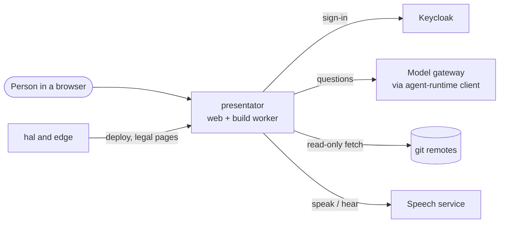
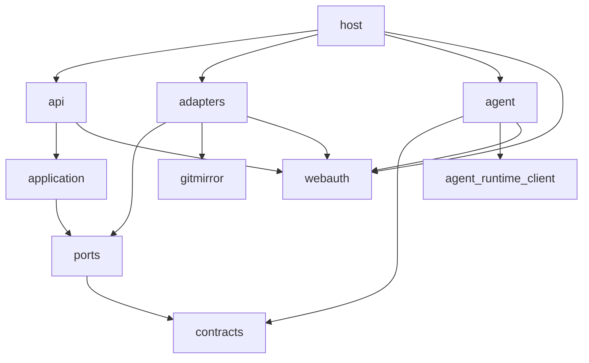
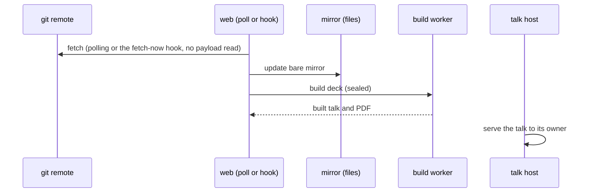

# presentator architecture

Audience: an engineer or agent about to change presentator who needs the mental
model first: what the parts are, which way they depend, and what the design
rests on. Exact behaviour lives in the [reference](reference/), the wish in
[VISION.md](VISION.md).

presentator is one web service that mirrors Slidev decks from git remotes,
builds each one sealed in a second service, and serves the built talk on its own
origin, with an AI co-presenter as an overlay in the presenter's browser.

## 1. Context and Scope

## 2. Building Block View

- **Layers.** `host` composes the instance and alone names an adapter
  (`adapters`, `agent` fill the ports); layers depend only downward
  (import-linter in `pyproject.toml`, run by the quality gate's
  `import-contract` rule). A library an adapter owns behind a port is barred
  above the adapters by its own contract; webauth only to `application`,
  `ports`, `contracts` (`api`, `host` import it); the web framework is exempt.
- **`src/gitmirror`** mirrors any remote read-only through `git`, does not
  import `presentator`, and only adapters name it. **`presentator.agent`** alone
  imports `agent_runtime_client`, at the tag `pyproject.toml` pins.
- **webauth** owns the sign-in routes, the gate, the origin check, the body caps
  and the cookies; presentator's SQLite stores fill its ports.
- **`frontend/`** is a SvelteKit single-page shell (`adapter-static`, `ssr =
  false`), built in the image; FastAPI serves it and no Node service runs.
- **`slidev/`** owns every theme and addon a deck may name, among them the
  overlay addon `slidev-addon-presentator`.
- **The build worker** (`host/worker.py`) runs every build step sealed.

## 3. Runtime View

See [sources](reference/sources.md), [builds](reference/builds.md),
[decks](reference/decks.md).

## 4. Deployment View

`compose.yaml` defines two services, `presentator` (web) and `build-worker`,
which hal deploys with `hal apply`. One process serves the lobby and the talk
host and tells them apart by the `Host` header (`served_by_host` in
`host/main.py`); a request for any other host gets a 404. The host keeps
Docker's default seccomp and AppArmor profiles in force and the image's glibc is
2.36 or later, because the controller reaches `pidfd_open` through ctypes. See
[start an instance](runbooks/start-an-instance-in-a-container.md) and
[configuration](reference/configuration.md). Edge's backup of the volume runs as
another user, so build runs are readable by others; a `staged-<step>` directory
is closed to everyone but the web, and that backup skips `staged-*` by name.

## 5. Crosscutting Concepts

**Persistence.** SQLite holds accounts, sessions, preferences, sources, runs,
decks and key drafts; files hold mirrors and builds. The database holds no file
content: a build's row names its directory and PDF, and a mirror's directory is
derived from its source's address. `builds/` and `mirrors/` are caches the rows
rebuild, so a restore of the database alone is enough. A column goes in two
releases, the second dropping it in `create_tables`, gated on
`pragma_table_info` (`adapters/schema.py`), so a restorable older backup starts.

**Authentication.** Keycloak groups decide who may enter
([sign-in](reference/sign-in-and-session.md)). There is no Redis: rate limits
are single-process (`SingleProcessRateLimitBackend`) and there is no session
cache. Identity writes run in one transaction under a process lock, with the
audit line after COMMIT (`adapters/identity.py`).

**Wire and errors.** JSON lives under `/api/` and every answer is a typed model.
A signed-out path is one exact optional path (`GET /api/session`), never a
prefix or a catch-all. A store failure while resolving a reader is a 500, never
a signed-out answer. Problems follow RFC 9457 (`api/problems.py`), and a problem
type is a `tag:` URI, because an https address breaks when its page moves.

**Words and look.** Every lobby word comes from the gettext catalogs through
Babel (`adapters/catalog.py`), and `scripts/check_catalog_purity.py` holds the
pages to it; a language is a file. The language is the instance's, the theme the
person's. The look comes from appkit, with presentator's teal in the app slot
(`frontend/src/app.css`). The overlay's controls use English literals, and the
room notice follows the deck's language.

**Trust.** A deck author's code, git remotes and people's input are untrusted.
The operator's settings, his local sources folder and hal's token clients are
trusted: a folder under the local-sources mount is read with his trust, with its
repositories, their metadata (a `gitdir` file, `objects/info/alternates`, a
symlink) and everyone who can write there. Across the speech service's private
Unix socket go readiness, PCM, transcript and spoken sentences; browser identity
and credentials do not. No operator blessing narrows this model yet, so an audit
keeps the default trust model.

**Proof.** A test sits at the layer that owns the behaviour; a lower layer
never stands in for a higher one. Pure logic (`contracts`, `application`) is
called directly with fakes at the ports. An adapter, `gitmirror` included, runs
against a temporary real dependency (a tmp SQLite file, a tmp bare repository).
Routes run through the real app in `TestClient`, the composition once with a
test configuration. Playwright drives the lobby over in-memory stores
(`tests/support/lobby_drive.py`); a delegated agent proves a person's flow at a
surface. A leak fails the run (`filterwarnings` in `pyproject.toml`).

## 6. Constraints and reasons

- A deck is code: its Vue components run in its build. Only the sealed [build
  worker](reference/builds.md) runs it; the web holds no Docker socket, group or
  client, drops every capability, takes no new privilege and has a read-only
  root, so deck code reaches neither the daemon nor the machine's root.
- The talk has its own origin: one cookie across both hosts would put deck code
  beside the credential it must not reach.
- One process writes the database: a second would need a second write lock over
  the one SQLite file, and the identity lock relies on one writer.
- The plain `http` hop to the model gateway is safe only because
  `hal_agent_presentator` has no host address and no published port; whom the
  gateway admits is hal's.
- Back-channel logout comes from inside, not through the trusted proxy, so its
  `X-Forwarded-For` is ignored.
- The fetch-now webhook holds a per-source secret, not a login: a git host has
  no browser ([sources](reference/sources.md)).
- `/api/admin/` takes a Keycloak access token, not a session cookie, so a forged
  browser session cannot erase a person; the path carries the subject, so the
  server keeps no access log ([people](reference/people.md)).
- The refresh token is stored in plain text because Keycloak renews it only with
  the client secret, which stays outside the database; the instance key belongs
  in the same backup.
- A change to what the instance stores or sends to a provider changes
  presentator's section in `legal/` in the same pull request.

## 7. Not chosen

- Redis or Postgres: one operator and no long job do not earn a second service.
  Reopens with a second writing process.
- Cloudflare Access in front, or an own password login: Keycloak is the one door
  and owns accounts and groups. Reopens if Keycloak leaves the fleet.
- A Docker socket in the web service: deck code runs only in the sealed worker.
  Reopens if builds stop running deck code.
- Deck uploads or editing in the lobby: a deck is a git folder, so history and
  the editor come with the remote. Reopens for authors without git.
- A deck's own dependencies: the build has no network, so `slidev/package.json`
  is the one set. Reopens if the build gains a registry.
- A wake word: the engines are proprietary or English-only; the AI hears only
  while the presenter has switched it on. Reopens with a self-hosted German one.
- Required pull request approvals: agents review before the pull request opens.
  Reopens if review moves to GitHub.
- A custom Sonar quality gate: the three coverage floors, all at 100 %
  (`fail_under` in `pyproject.toml`, `slidev/vitest.config.ts`, the lobby's
  check in `frontend/scripts/merge-coverage.ts`), are stricter than any gate's
  and the other conditions match. Reopens if a floor drops below 100 %.

## 8. Risks and Technical Debt

- The overlay's palette can clash with a deck's palette.
- The git child's environment holds the credential and is readable by the same
  user; a Python `str` cannot be wiped.
- A database copy plus the client secret renews a session until the SSO session
  ends; deleting a row revokes nothing, and freed pages, the `-wal` and backups
  keep ended tokens.
- The hosts are same-site, so deck code on the talk host can set `Domain=`
  cookies for the shared domain.
- Each presenter window mounts its own overlay; nothing enforces one speaker.
- An empty or older database is not guarded against: its retention pass deletes
  the runs only the right database names.
