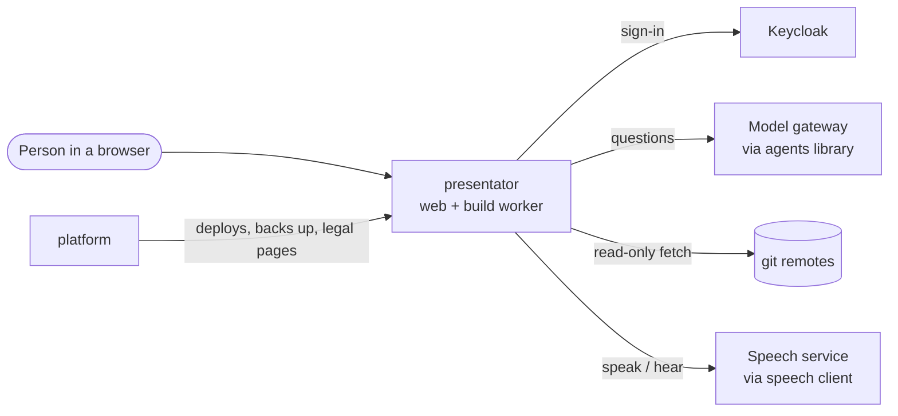
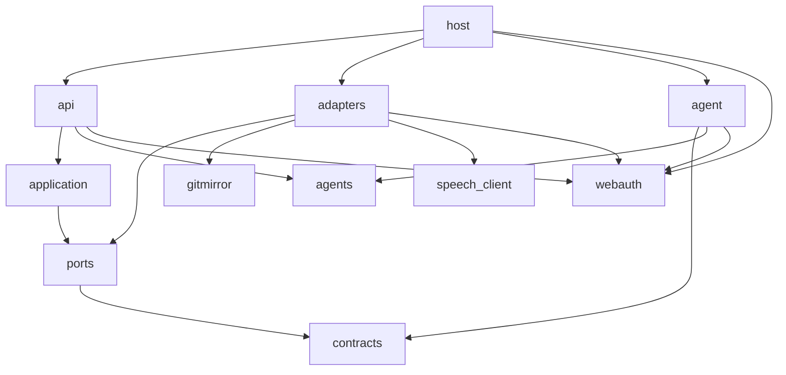
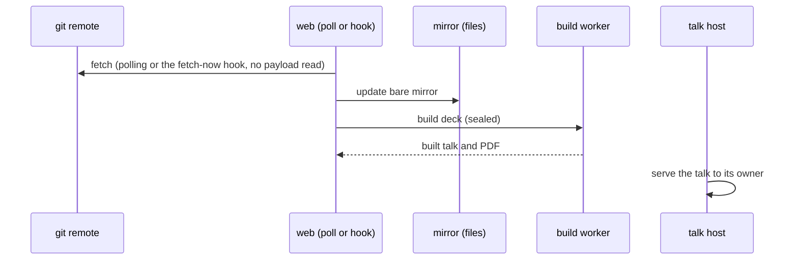
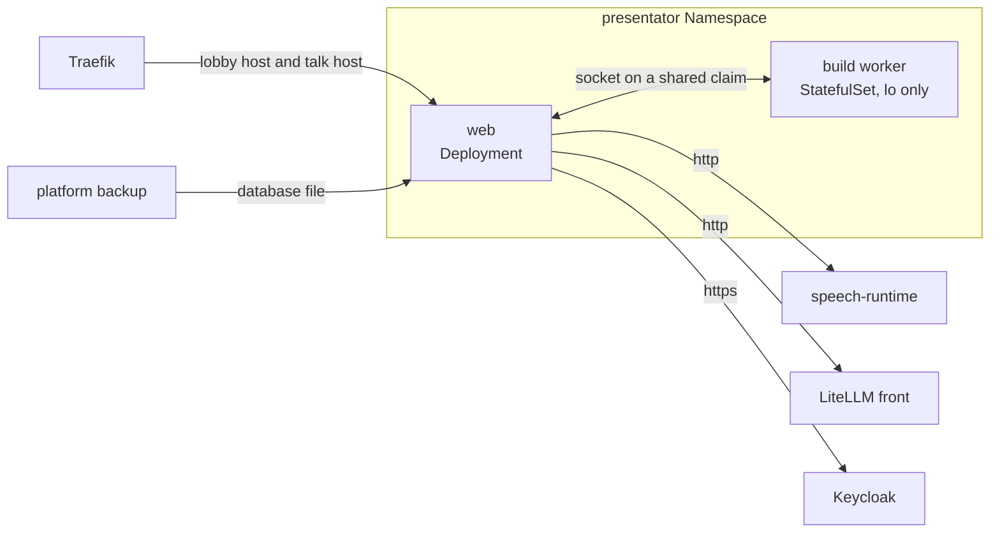

# presentator architecture

Audience: an engineer or agent about to change presentator who needs the mental
model first: what the parts are, which way they depend, and what the design
rests on. Exact behaviour lives in the surface pages routed from the
[README](../README.md#documentation), the wish in [VISION.md](VISION.md).

presentator is one web service that mirrors Slidev decks from git remotes,
builds each one sealed in a second service, and serves the built talk on its own
origin, with an AI co-presenter as an overlay in the presenter's browser.

## 1. Context and Scope

## 2. Building Block View

- **Layers.** `host` composes the instance and alone names an adapter
  (`adapters`, `agent` fill the ports); layers depend only downward
  (import-linter in `pyproject.toml`, run by the gate's `import-contract` rule).
  A library an adapter owns behind a port is barred above the adapters by its
  own contract; webauth is barred only from `application`, `ports`, `contracts`,
  as `api` and `host` import it; the web framework is exempt. `api` alone may
  import one module of a barred library, `agents.tools`, to
  declare, beside each route, whether an agent may call it.
- **`src/gitmirror`** mirrors any remote read-only through `git`, does not
  import `presentator`, and only adapters name it. **`presentator.agent`** imports
  `agents` at the tag `pyproject.toml` pins, and `presentator.api`
  only its `tools` module (`tests/presentator/agent/test_backend_imports.py`
  holds that line, which import-linter cannot draw inside one package). Only adapters
  import `speech_client`, the pinned client that owns the speech wire, its
  upgrade headers, server events, health fetch, hearing session and the relay of
  a browser's audio to it; `adapters/session_access.py` is
  the one read of what the issuer grants a signed-in session.
- **webauth** owns the sign-in routes, the gate, the origin check, the body caps
  and the cookies; presentator's SQLite stores fill its ports.
- **`frontend/`** is a SvelteKit single-page shell (`adapter-static`, `ssr =
  false`), built in the image; FastAPI serves it and no Node service runs.
- **`slidev/`** owns every theme and addon a deck may name, among them the
  overlay addon `slidev-addon-presentator`. The overlay captures the microphone
  through speech's browser package, which opens the hearing socket itself and
  owns the capture and the frame format.

## 3. Runtime View

## 4. Deployment View

presentator has one deployment, on the platform's k3s cluster. One image runs
as two workloads in presentator's own Namespace: the web, a one-replica
Deployment that recreates instead of rolling, and the build worker, a
one-replica StatefulSet. Both are on the node of one claim mounted at
`/run/presentator-build`, where the worker's socket lies. The platform's
manifest, `apps/presentator` in overnightworks/platform, owns the pod specs,
the volumes, the settings and origins they set and the secret files; the
[configuration](configuration.md) owns what each setting means.

One process serves the lobby and the talk host and tells them apart by the
`Host` header (`served_by_host` in `host/main.py`); a request for any other host
gets a 404, except the lobby's back-channel logout path, which the lobby answers
to a `POST` under any Host but the talk host's (other methods on that path
answer 405). The route ignores forwarded headers, and the signed Logout Token is
its only control. The platform's realm registers no back-channel logout URL for
presentator, so whether and from where the identity provider calls the path is
the deployment's decision, and presentator's safety does not depend on it. The image's glibc is 2.36 or later,
because the controller reaches `pidfd_open` through ctypes. Both hosts answer
`GET /health` with a fixed 200 and no session, store read or cookie
(`api/health.py`); the port opens only after the database is migrated and the
worker answers, so an answer means it serves. The request must name a served
host: the platform's probe does, a direct run must.

The web reaches the speech service and the model gateway by the origins its
settings name, which are services inside the cluster, and Keycloak at its
issuer address. The platform owns the pod's seal, the network policy, the edge,
the volumes, the backup of the database file with its restore test and the
release the cluster runs; the worker's pod holds `lo` alone because the init
container `remove-link` deletes its network link before the worker starts. The
worker's container never restarts, so each life ends its pod and the
StatefulSet makes a fresh one. Neither pod holds a Kubernetes API right, and
the worker's pod mounts no service-account token.

presentator owns what it checks itself: the worker's self-check, the migration
of its own database at start (the web opens its port only after that migration
and an answer from the worker; the health route then answers a fixed 200) and
the validation of its settings, which refuses a start that names a wrong value.
A release is tagged only after `release.yml` has driven its published image
through the k3d probe (`scripts/probe_build_worker_k3d.py`) against
`apps/presentator` at the platform commit the probe pins.

## 5. Crosscutting Concepts

**Persistence.** SQLite holds accounts, sessions, preferences, sources, runs,
decks and key drafts; files hold mirrors and builds. The database holds no file
content: a build's row names its directory and PDF, and a mirror's directory is
derived from its source's address. `builds/` and `mirrors/` are caches the rows
rebuild, so a restore of the database alone is enough. A column goes in two
releases, the second dropping it in `create_tables`, gated on
`pragma_table_info` (`adapters/schema.py`), so a restorable older backup starts.
The drop is tagged once a release with the first step has been live, since the
platform pins one release and a bump may skip those between, so an earlier drop
may skip the first release.

**Authentication.** Keycloak groups admit people ([sign-in](sign-in.md)). There
is no Redis or session cache: rate limits are single-process
(`SingleProcessRateLimitBackend`). Identity writes run in one transaction under
a process lock, with audit after COMMIT (`adapters/identity.py`).

**Wire and errors.** JSON lives under `/api/` and every answer is a typed model.
A signed-out path is one exact optional path (`GET /api/session`), never a
prefix or a catch-all. A store failure while resolving a reader is a 500, never
a signed-out answer. Problems follow RFC 9457 (`api/problems.py`), and a problem
type is a `tag:` URI, because an https address breaks when its page moves.

**Words and look.** Every lobby word comes from one gettext catalog per
language (`frontend/src/lib/catalogs`), from which `design-catalogs` writes a
typed module per language for the page and one Python module for the server
(`contracts/words.py`); a language is a catalog file. The page loads the words
of its language once, in the root load, from the language `/api/session` names;
the session answer carries that tag and no sentence. The root load fetches the
design kit's words for its components (sign-in page, account menu) in the same
language and hands them over as `words`; presentator overrides none. The
server words only the logout page's button. `scripts/check_catalog_purity.py` holds the pages to the
catalogs. The language is the instance's unless a signed-in person's account
names one a catalog speaks, and English stands in where none does
(`DEFAULT_LANGUAGE`); the theme is the person's. The look
is design's, with presentator's teal in the app slot (`frontend/src/app.css`).
The overlay's controls use English literals. The room notice follows the deck's
language and reads its words from the overlay's own catalog pair
(`slidev/catalogs`, generated into `slidev/words`): the overlay is a separately
shipped unit that builds decks without network, so it cannot import the lobby's
words and owns its own, imported statically so that a projector opened late shows
the notice without the server.

**Trust.** A deck author's code, git remotes and people's input are untrusted.
The operator's settings, his local sources folder and hal's token clients are
trusted. A folder under the local-sources mount is read with the operator's
trust: its repositories, their metadata (a `gitdir` file,
`objects/info/alternates`, a symlink) and everyone who can write there. Across
the shared speech service, over the plain `http` origin its setting names, go readiness,
PCM, transcripts, spoken sentences and two tokens: the person's access token, which
carries the account's subject and group memberships, and presentator's workload
token beside it. Browser cookies and session credentials are not forwarded; what the
service keeps, logs and admits is the shared section `#sprachdienst`. No operator blessing
narrows this model yet, so an audit keeps the default trust model.

The platform is trusted to confine the build worker's pod: that deck code there
reaches no network and holds no mount, right or limit beyond what the pod grants
is platform's proof, in platform's CI. presentator proves its own product in
that pod: the worker's self-check refuses a pod that is not sealed as
§6 requires, the web becomes Ready against the worker, and a deck builds and
exports there.

A bearer enters the lobby through two paths besides hal's token clients, and
both take `/mcp` and the routes marked as tools, and nothing that deletes,
shares, publishes, sends outward or is admin. The `agents` client's token, whose
only audience is the app's `/mcp`, acts as the person behind its subject. A token
of a service account in the realm's agent group, with the app's groups and `/mcp`
audience, is admitted from any client the realm authorizes: its first call
creates the agent's own account, which owns no deck and sees none. Without a
bearer the cookie session and its CSRF check decide as before.

**Proof.** A test sits at the layer that owns the behaviour; a lower layer never
stands in for a higher one. Pure logic (`contracts`, `application`) is called
directly with fakes at the ports. An adapter, `gitmirror` included, runs against
a temporary real dependency (a tmp SQLite file, a tmp bare repository). Routes
run through the real app in `TestClient`, the composition once with a test
configuration. Playwright drives the lobby over in-memory stores
(`tests/support/lobby_drive.py`); a delegated agent proves a person's flow at a
surface. A leak fails the run (`filterwarnings` in `pyproject.toml`).

## 6. Constraints and reasons

- A deck is code: its Vue components run in its build. Only the sealed build
  worker runs it; the web holds no right in the Kubernetes API, drops every
  capability, takes no new privilege and has a read-only root, so deck code
  reaches neither the cluster nor the node's root.
- The pod is sealed where a pod can be. It holds `lo` alone because an init
  container removes its link before the worker starts. `/work`, `/tmp` and
  `/dev/shm` are memory volumes that allow execution, because a pod cannot mount
  them `noexec` and deck code can already execute from memory; no new privilege
  and no device-node capability keep `nosuid` and `nodev` moot. The process bound
  is `RLIMIT_NPROC` at 512 per build uid, because the platform sets no bound per
  pod and deck code runs under one of the two build uids.
- The talk has its own origin: one cookie across both hosts would put deck code
  beside the credential it must not reach.
- One process writes the database: a second would need a second write lock over
  the one SQLite file, and the identity lock relies on one writer.
- The web reaches the speech service and the model gateway over plain `http` at
  the origins its settings name, which on the platform are Service addresses
  inside the cluster. presentator sends its workload token and the person's token
  over that hop and relies on the deployment to keep it inside the cluster; its
  settings validation only refuses an origin that is not a bare `http` origin
  (the speech service) or a bare `http` or `https` origin (the gateway), and a
  gateway CA file with an `http` origin. The platform decides whom the gateway
  admits.
- The back-channel logout route ignores forwarded headers, so `X-Forwarded-For`
  does not decide anything there. The platform's realm registers no logout URL
  for presentator; registering it and the path to it belong to the deployment.
- The fetch-now webhook holds a per-source secret, not a login: a git host has
  no browser ([fetch-now hook](runbooks/call-the-fetch-now-hook.md)).
- `/api/admin/` takes a Keycloak access token, not a session cookie, so a forged
  browser session cannot erase a person; the path carries the subject, so the
  server keeps no access log ([people](people.md)).
- The refresh token is plain text because Keycloak renews it only with the
  client secret, outside the database. The instance key is a secret file the
  deployment supplies, outside the database and its backup; on the platform it
  is in `platform-secrets`, and a restore needs both.
- A change to what the instance stores or sends to a provider changes
  presentator's section in `legal/` in the same pull request.

## 7. Not chosen

- Redis or Postgres: one operator and no long job do not earn a second service.
  Reopens with a second writing process.
- Cloudflare Access in front, or an own password login: Keycloak is the one door
  and owns accounts and groups. Reopens if Keycloak leaves the fleet.
- A right in the cluster's API for the web pod: deck code runs only in the sealed
  worker.
  Reopens if builds stop running deck code.
- Deck uploads or editing in the lobby: a deck is a git folder, so history and
  the editor come with the remote. Reopens for authors without git.
- A deck's own dependencies: the build has no network, so `slidev/package.json`
  is the one set. Reopens if the build gains a registry.
- A wake word: the engines are proprietary or English-only; the AI hears only
  while the presenter has switched it on. Reopens with a self-hosted German one.
- Required pull request approvals: agents review before the pull request opens.
  Reopens if review moves to GitHub.
- A custom Sonar quality gate: the three coverage floors, all at 100 %
  (`fail_under` in `pyproject.toml`, `slidev/vitest.config.ts`, the lobby's
  check in `frontend/scripts/merge-coverage.ts`), are stricter than any gate's
  and the other conditions match. Reopens if a floor drops below 100 %.

## 8. Risks and Technical Debt

- The overlay's palette can clash with a deck's palette.
- The git child's environment holds the credential and is readable by the same
  user; a Python `str` cannot be wiped.
- A database copy plus the client secret renews a session until the SSO session
  ends; deleting a row revokes nothing, and freed pages, the `-wal` and backups
  keep ended tokens.
- The hosts are same-site, so deck code on the talk host can set `Domain=`
  cookies for the shared domain.
- Each presenter window mounts its own overlay; nothing enforces one speaker.
- The presenter bar is teleported into Slidev's presenter page markup, which
  Slidev does not promise; a Slidev upgrade that moves it shows as a failing
  presenter-controls test.
- In the pod the claim root is born open to everyone, so the web could leave an
  entry there before the worker's first start; the worker then refuses with
  `stale-socket`, and its children never reach the directory.
- In the pod the web records a build under its own toolchain identity, not the
  worker's. In a rollout that changes the toolchain, one
  deck's build can still reach the old worker pod before the StatefulSet
  replaces it. That deck then keeps the old toolchain's talk, or its failure,
  recorded under the new identity, until its next push or the next toolchain
  change. The rollout order holds the window to one build: the StatefulSet
  replaces the old pod at the rollout, and its update strategy must not be
  `OnDelete`.
- An empty or older database is not guarded against: its retention pass deletes
  the runs only the right database names.
