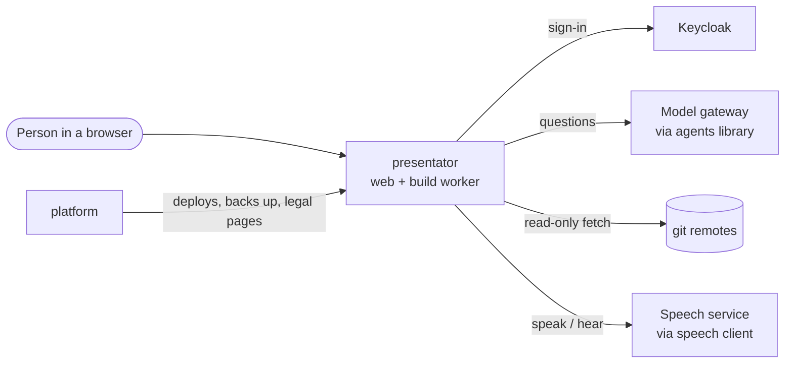
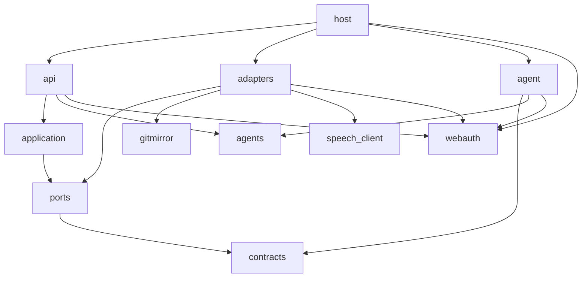
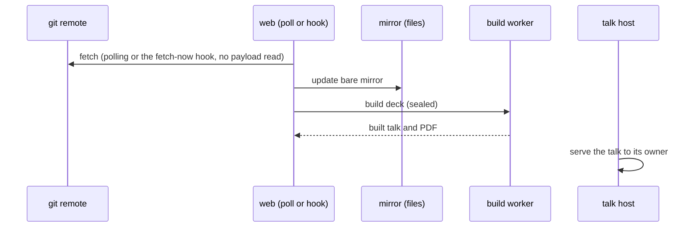
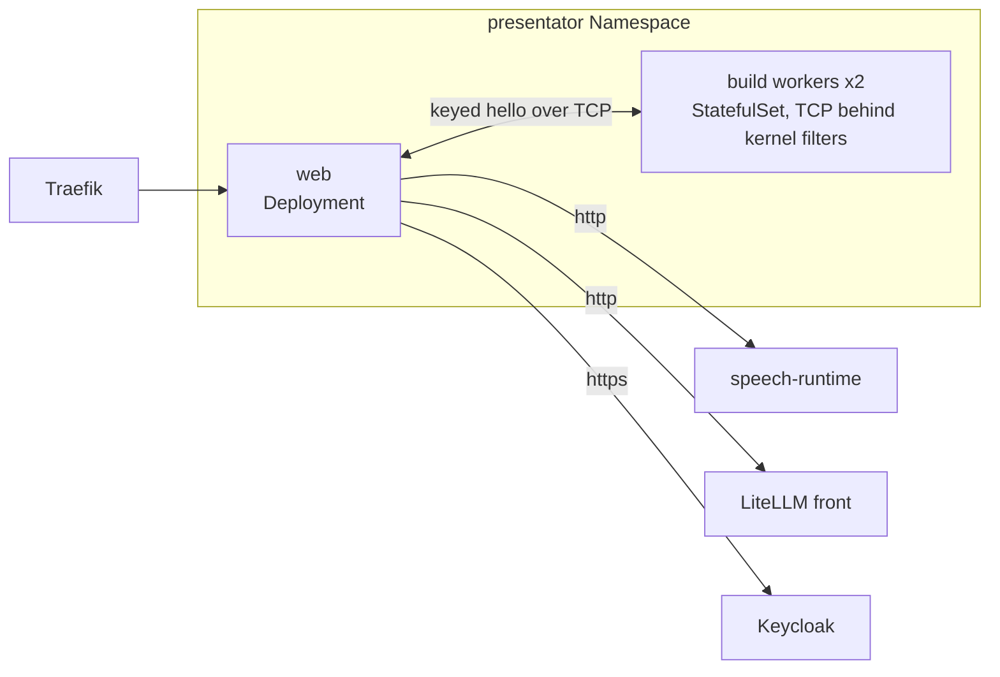

# presentator architecture

Audience: an engineer or agent about to change presentator who needs the mental model first. Exact
behaviour lives in the surface pages routed from the [README](../README.md#documentation), the wish
in [VISION.md](VISION.md).

presentator is one web service that mirrors Slidev decks from git remotes, builds each one sealed in
a second service, and serves the built talk on its own origin, with an AI co-presenter as an overlay
in the presenter's browser.

## 1. Context and Scope

## 2. Building Block View

- **Layers.** `host` composes the instance and alone names an adapter; layers depend only downward
  (import-linter in `pyproject.toml`). A library an adapter owns behind a port is barred above the
  adapters; webauth is barred only from `application`, `ports`, `contracts`. `api` alone may import
  `agents.tools`, to declare beside each route whether an agent may call it.
- **`src/gitmirror`** mirrors any remote read-only through `git` and does not import `presentator`;
  only adapters import it.
- **`speech_client`** is the pinned package that owns the speech wire; only adapters import it.
- **webauth** owns the sign-in routes, the gate, the origin check, the body caps and the cookies;
  presentator's stores fill its ports.
- **`frontend/`** is a SvelteKit single-page shell built in the image; FastAPI serves it and no Node
  service runs.
- **`slidev/`** owns every theme and addon a deck may name, among them the overlay addon
  `slidev-addon-presentator`.

## 3. Runtime View

## 4. Deployment View

One image runs as two workloads in presentator's Namespace on the platform's k3s cluster: the web, a
Deployment that recreates instead of rolling, and the build workers, a StatefulSet of two pods that
share nothing and each serve one life at a time. The platform's manifest (`apps/presentator` in
overnightworks/platform) owns the pod specs, network policy, edge, secrets, backup and release; the
[configuration](configuration.md) owns each setting's meaning.

One process serves the lobby and the talk host and tells them apart by the `Host` header; any other
host gets a 404, except the lobby's back-channel logout path ([sign-in](sign-in.md)). `GET /health`,
the readiness probe, answers 200 while the Postgres database passes the revision rule and Redis
answers a ping, else a fixed 503; liveness asks neither, since a restart cures neither. The web
starts without a worker. On SIGTERM it turns unready first, takes no new ask or hearing, lets a
running answer finish and writes `process.stopped`.

A worker pod keeps a link that reaches only the web: its init container loads nftables rules that
let nothing leave but the loopback and the replies of accepted connections, so a deck's code (the
build and wire uids) reaches only the pod, and the self-check requires `EPERM` as each uid. The root
controller verifies a keyed hello (nonces, HMAC-SHA256, a deadline) before it spawns anything. Each
life ends the pod and the StatefulSet makes a fresh one.

## 5. Crosscutting Concepts

**Persistence.** Postgres (`PRESENTATOR_DATABASE_URL`) holds the state. A build is one run (talk, deck
text, PDF) in the S3 bucket all pods share, named by its row and served from a bounded copy on each pod's
disk; it and each pod's mirrors are caches the rows rebuild. The ssh host keys every pod trusts are rows.
`serve` creates no table; `presentator migrate` runs the migrations of `adapters/postgres` under a lock. A
revision behind this release is refused at start; a newer one is served, and a stored word it does not
know reads as its generic case, logged once. An unknown role or account kind fails loud.

**Authentication and wire.** Keycloak groups admit people ([sign-in](sign-in.md)). There is no
session cache: rate limits live in the Redis every pod shares (webauth's `RedisRateLimitBackend`,
one budget per host), and identity writes run in one transaction under a lock (advisory on
Postgres). JSON lives under `/api/` as typed models. The one signed-out path is `GET
/api/session`, and a store failure while resolving a reader is a 500, never a signed-out answer.
Problems follow RFC 9457 with `tag:` URI types.

**Logging.** logline owns it, configured first in each process: every line is one JSON object. One
line per HTTP request names the route template, never the path, with `sub` and the client address
from webauth's decisions (`api/request_line.py`). Every other line is a literal `<noun>.<verb_past>`
event of ids, counts and codes: the web writes `process.started`, `process.ready` and
`process.stopped`, and a start the settings, the database or the worker's self-check refuse ends in
`process.failed` with a `reason` code and exit status 1 (`presentator`) or 2 (`presentator-worker`).
The co-presenter's events are in [co-presenter](co-presenter.md).

**Words and look.** Every lobby word comes from one gettext catalog per language
(`frontend/src/lib/catalogs`), generated into typed modules for page and server; the session answer
carries a language tag, no sentence. The overlay owns its pair ([co-presenter](co-presenter.md)).

**Trust.** A deck author's code, git remotes and people's input are untrusted. The operator's
settings and hal's token clients are trusted. The shared speech service gets readiness, PCM,
transcripts, spoken sentences and two tokens (the person's access token and presentator's workload
token) over its plain `http` origin; cookies are not forwarded, and what the service keeps is the
shared section `#sprachdienst`. No operator blessing narrows this model, so an audit keeps the
default. The platform confines the worker's pod; presentator's k3d CI job applies the platform's
manifests to run the worker's self-check.

A bearer enters the lobby through two paths besides hal's token clients, both limited to `/mcp` and
the routes marked as tools, never one that deletes, shares, publishes, sends outward or is admin: the
`agents` client's token, which acts as its subject's person, and a service account's token in the
realm's agent group, whose first call creates an agent account that owns and sees no deck. Without
a bearer the cookie session and its CSRF check decide.

**Proof.** A test sits at the layer that owns the behaviour: pure logic runs with fakes at the
ports, an adapter against a temporary real dependency, routes through the real app in `TestClient`.
A delegated agent proves a person's flow at a surface; a leak fails the run.

## 6. Constraints and reasons

- A deck is code: its Vue components run in its build. Only the sealed build worker runs it; the web
  holds no right in the Kubernetes API and the worker's pod mounts no service-account token, so deck
  code reaches neither the cluster nor the node's root.
- `/work`, `/tmp` and `/dev/shm` are memory volumes that allow execution, because a pod cannot mount
  them `noexec` and deck code can already execute from memory. The process bound is `RLIMIT_NPROC`
  at 512 per build uid, since the platform sets no bound per pod.
- The talk has its own origin: one cookie across both hosts would put deck code beside the
  credential it must not reach.
- Processes share state only through Postgres and Redis. Every write that needs one winner takes an
  advisory lock; the refresh holds a session lock on a pinned connection and bumps an epoch in
  `refresh_owner`, which every refresh and removal write reads `FOR SHARE`, so a holder whose
  connection ended is refused. The ask lease is a Redis key (`SET NX PX`) that expires with the
  agent's deadline and is freed only by its holder's token. Redis keeps nothing durable; while it
  cannot answer, every request but `/health` is a 503, since webauth's limiter fails closed.
- The speech origin is plain `http` and the gateway's `http` or `https`, both at Service addresses
  inside the cluster; presentator sends the workload token and the person's token over that hop and
  relies on the deployment to keep it there.
- The fetch-now webhook holds a per-source secret, not a login: a git host has no browser
  ([hook](runbooks/call-the-fetch-now-hook.md)). `/api/admin/` takes a Keycloak access token, not a
  session cookie, so a forged browser session cannot erase a person ([people](people.md)).
- The refresh token is plain text because Keycloak renews it only with the client secret, outside
  the database. The instance key is a secret file outside the database and its backup.

## 7. Not chosen

- Cloudflare Access in front, or an own password login: Keycloak is the one door. Reopens if Keycloak
  leaves the fleet.
- A right in the cluster's API for the web pod: deck code runs only in the sealed worker. Reopens if
  builds stop running deck code.
- Deck uploads or editing in the lobby: a deck is a git folder, so history and editor come with the
  remote. Reopens for authors without git.
- A deck's own dependencies: the build has no network, so `slidev/package.json` is the one set.
- A wake word: the engines are proprietary or English-only. Reopens with a self-hosted German one.
- Required pull request approvals: agents review before it opens. Reopens if review moves to GitHub.

## 8. Risks and Technical Debt

- The git child's environment holds the credential, readable by the same user.
- A database copy plus the client secret renews a session until the SSO session ends; deleting a row
  revokes nothing, and freed pages, the `-wal` and backups keep ended tokens.
- The hosts are same-site: deck code on the talk host can set `Domain=` cookies.
- The overlay's palette can clash with a deck's palette.
- Each presenter window mounts its own overlay; nothing enforces one speaker.
- The presenter bar is teleported into Slidev's presenter markup, which Slidev does not promise.
- A toolchain rollout can let one deck's build reach the old worker pod, its result recorded under
  the new identity until its next push; the update strategy must not be `OnDelete`.
